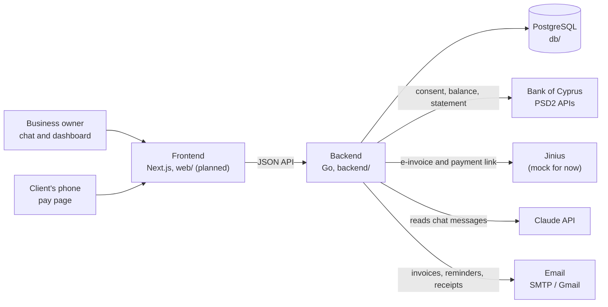

# Kerdos

**Kerdos** (κέρδος, Greek for "profit") is an AI assistant that helps small businesses in Cyprus get paid on time and see cash gaps before they happen.

Built at the **Bank of Cyprus Fintech Hackathon 7.0** (27–29 November 2026, Nicosia), track #4: Fintech for SMEs & Entrepreneurship.

## The problem

Cafés, tradespeople and freelancers rarely fail for lack of customers. They fail because money comes in later than it goes out:

- **Late payments.** Invoices go out over WhatsApp or on paper, clients pay 45–90 days late, and chasing them is awkward.
- **Cash gaps.** Owners find out the account will go negative only when rent, salaries, the 13th salary or insurance bounces.

## What Kerdos does

1. **Invoice in one sentence.** "Invoice Kostas, 3 hours at €40" becomes an invoice. It goes out at once with a payment link, plus an email copy.
2. **Chases payments for you.** Reminders start after the due date and get firmer each time (polite → firm → final). The owner always sees who owes what.
3. **Warns you before you go negative.** The forecast combines the bank balance, upcoming bills, and each unpaid invoice on the day *that client* usually pays: "In 12 days you'll be €800 negative."
4. **Offers a way out.** Remind specific clients, or get money now against your unpaid invoices. Financed invoices stop being chased.

### The 2-minute demo

1. The owner types **"Invoice Kostas €120"**. The invoice arrives on a second phone, and Kostas can pay it there.
2. **Skip time** by 3 days. A deposit lands, and Kerdos sends Andreas a firm reminder automatically.
3. Kerdos warns: **"In 9 days you'll be €800 negative. Get €800 now?"** One tap, and the gap closes.

## How it fits together



- **Database:** the business rules live in PostgreSQL views and functions: overdue status, reminders due, the forecast, financing. The API and the tests use the same rules.
- **Backend:** a Go JSON API. Every outside service sits behind an interface with a mock, so **the demo never depends on a service being up**.
- **Frontend:** `mockup/` is the clickable design reference today. The Next.js app follows the spec in `docs/superpowers/specs/`.

## Quick start

You need Docker and Go 1.22+.

```sh
# 1. Database (create db/.env first, see db/README.md)
docker compose -f db/compose.yaml --env-file db/.env up -d db
docker compose -f db/compose.yaml --env-file db/.env run --rm migrate up
docker compose -f db/compose.yaml --env-file db/.env exec -T db \
  psql -U kerdos -d kerdos -v ON_ERROR_STOP=1 --single-transaction < db/seed/sample.sql

# 2. Backend (copy .env.example to .env and set KERDOS_DATABASE_URL first)
cd backend
go mod tidy
go run ./cmd/kerdos-api        # http://localhost:8080/healthz

# 3. Try the demo through the API
curl -X POST localhost:8080/api/chat -d '{"text":"Invoice Kostas €120"}'
curl -X POST localhost:8080/api/demo/skip -d '{"days":3}'
curl localhost:8080/api/forecast
```

To see the design without running anything, open `mockup/index.html` in a browser.

No keys are needed: the bank, Jinius, email and chat parsing all have working mocks. Add `ANTHROPIC_API_KEY`, the `SMTP_*` settings or `KERDOS_BANK=boc` with the `BOC_*` settings to switch the real ones on (see `.env.example`).

## Status

| Part | State |
|---|---|
| Database schema, demo data, rules | Done; checked by `db/tests/demo_story.sql` |
| Backend API (chat, invoices, reminders, forecast, financing, pay page, demo controls) | Prototype; checked by an end-to-end test through the API |
| Chat parsing | Rule-based, or Claude when a key is set (falls back to the rules on any failure) |
| Email | Logged, or sent over SMTP (for example Gmail) |
| BoC open banking (consent, balance, transactions, matching payments to invoices) | Client written and tested against the BoC documentation's samples; not yet run against the live sandbox |
| Jinius e-invoicing | Mock: no public API docs yet, access to be confirmed with the organisers |
| "Pay now" through BoC, financing offers | Simulated |
| Next.js frontend, Google sign-in, Sheets export, budgets | Not built yet |

All names, amounts and dates in the demo are sample data.

## Repository

```
backend/    Go API: see backend/README.md
db/         PostgreSQL schema (migrations), sample data, demo test: see db/README.md
docs/       data-model.md (data model and team decisions), superpowers/ (mockup and frontend specs)
mockup/     clickable HTML mockup, the visual reference
KERDOS_BRIEF.md   project brief
.env.example      every setting, with comments (copy to .env, never commit .env)
```

## Licence

Released under [CC BY-SA 4.0](https://creativecommons.org/licenses/by-sa/4.0/), as the hackathon rules require.
