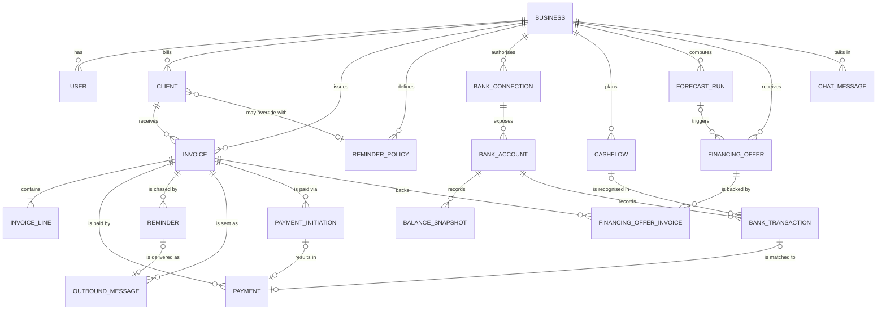

# Kerdos: data model (MVP)

Status: team decisions applied, 2026-11-27. **Implemented** in `db/migrations/000001_init.up.sql` (PostgreSQL), which merges this model with the first `db/` schema: one company, Google sign-in, a Gmail queue, invoices you owe, and budgets. The entity sections below are the logical model. See [In the database](#in-the-database) for the real table names and the places where the schema differs.

Sources: `KERDOS_BRIEF.md`, the mockup in `mockup/`, and the BoC "APIC Portals Documentation" (Sep 2024): subscription flow, Accounts API (accounts, balance, statement) and Payments API (initiate, execute).

★ marks the tables the 2-minute demo cannot run without. The rest are thin, but they are here so nothing has to be reshaped on Saturday.

---

## Conventions

- **IDs**: `uuid` in the database. The `biz_`, `cli_` and similar prefixes below only label the entity types.
- **Money**: integer minor units (cents) plus a currency code, in fields named `*_cents`. €40.50 is `4050`. Never floats. The mockup uses floats, so convert at the boundary.
- **Rates**: the database stores VAT as `numeric(4,2)` percent (`19.00`). The `*_bp` fields below are the logical equivalent.
- **Dates**: `date` for business dates (issue, due, cash-flow day), read in the business's timezone (`Europe/Nicosia`). `timestamp` (UTC) for events (sent, paid, synced).
- **Tenancy**: one company per database (`company` holds exactly one row), so the `business_id` fields below are not in the schema.
- **External links**: rows that come from or go to an outside system carry `provider` (`jinius`, `boc` or `mock`) and `external_id`. Real and mock adapters write the same rows, which is the brief's rule ("mock or adapter behind the same interface"). `(provider, external_id)` is unique wherever it appears.
- **Audit columns**: every table also has `created_at` and `updated_at`. They are left out of the tables below.
- **Derived values** (overdue, outstanding, debtor totals, the forecast itself) are computed, not stored, unless a table below says otherwise.
- **"Today"** is `kerdos_today()`: the real local date plus `company.clock_offset_days`. That one field is the demo's "Skip time" button.

---

## In the database

Where each entity lives in `db/migrations/000001_init.up.sql`, and where the schema differs from the sections below.

| Logical entity | Table or object | Difference |
|---|---|---|
| Business | `company` (one row) | No tenancy. VAT is stored as a percent |
| User | `users`, `google_tokens`, `sessions` | Google sign-in; tokens encrypted, sessions hashed |
| Client | `counterparties` | Covers suppliers too. `avg_days_late` is the view `counterparty_payment_stats`, so it is computed rather than cached |
| Invoice, InvoiceLine | `invoices`, `invoice_lines` | `direction` is `receivable` or `payable`, so bills you owe (rent, insurance) are invoices too. Line `net_cents` and `vat_cents` are generated columns. "Financed" is `invoices.financed_by_offer_id`. The display status is in the view `invoice_overview` |
| Payment | `payments` | `received_on` is a business date. A trigger marks the invoice paid and cancels queued reminders |
| PaymentInitiation | `payment_initiations` | |
| ReminderPolicy | `reminder_policies`, `message_templates` | Timing and wording are split. `before_due_days` adds nudges before the due date |
| Reminder, OutboundMessage | `outbound_messages` | One table is both the send log and the job queue (`kind`, `sequence`, `tone`, `business_date`, `dedupe_key`). Due reminders come from the view `reminders_due` |
| BankConnection, BankAccount, BalanceSnapshot, BankTransaction | `bank_connections`, `bank_accounts`, `balance_snapshots`, `bank_transactions` | Snapshots carry `business_date`. Transactions link to payments through `payments.bank_transaction_id` |
| Cashflow | `cashflows` | Use these for money that isn't a bill (deposits, salaries). Rent and insurance are payable invoices in the seed |
| ForecastRun | `forecast_runs`, plus `forecast_events()`, `forecast_points()`, `forecast_shortfall()` | The forecast rules are implemented in SQL |
| FinancingOffer, FinancingOfferInvoice | `financing_offers`, `financing_offer_invoices`, `accept_financing_offer()` | |
| ChatMessage | `chat_messages` | |
| (not in this model) | `budgets`, `audit_log`, `invoice_counters` | From the first `db/` schema |

The demo seed is `db/seed/sample.sql`. `db/tests/demo_story.sql` checks every number in the demo seed section below, plus the safety rules.

---

## Overview

Five areas:

1. **Business and people**: Business, User, Client
2. **Invoicing**: Invoice, InvoiceLine, Payment
3. **Reminders and messages**: ReminderPolicy, Reminder, OutboundMessage
4. **Bank and cash**: BankConnection, BankAccount, BalanceSnapshot, BankTransaction, PaymentInitiation, Cashflow
5. **Forecast, financing and chat**: ForecastRun, FinancingOffer, FinancingOfferInvoice, ChatMessage

---

## 1. Business and people

### Business ★
The small business using Kerdos. It is the tenant.

| Field | Type | Notes |
|---|---|---|
| id | id | `biz_` |
| name | text | Trading name printed on invoices, for example "Nicosia Studio" |
| legal_name | text? | |
| tax_id | text? | Cyprus TIC or VAT number, printed on invoices when set |
| vat_registered | bool | When false, new invoice lines get `vat_rate_bp = 0` |
| default_vat_rate_bp | int | Used for new lines when `vat_registered` |
| email | text | Reply-to address on invoice and reminder emails |
| phone | text? | |
| address | text? | |
| iban | text? | Printed on invoices for manual transfer |
| currency | text | `EUR` |
| language | enum | `en`, `el`, `ru`. Default language for the UI and outgoing messages |
| timezone | text | `Europe/Nicosia` |
| payment_terms_days | int | Default due date offset. 14 in the mockup |
| invoice_prefix | text | For example `INV-` |
| next_invoice_seq | int | Sequential invoice numbering, no gaps. Increment in the same transaction that issues the number |
| clock_offset_days | int | Demo only. "Skip time" adds to it. Always 0 in real use |

### User
Someone who logs in. The MVP has one owner per business, and auth can be a stub.

| Field | Type | Notes |
|---|---|---|
| id | id | `usr_` |
| business_id | id → Business | |
| email | text | Unique |
| name | text | |
| role | enum | `owner` (the only role in the MVP) |

### Client ★
Someone the business invoices: Kostas, Elena's Bakery. Also the debtor.

| Field | Type | Notes |
|---|---|---|
| id | id | `cli_` |
| business_id | id → Business | |
| name | text | What the owner types in chat. Unique per business, case-insensitive |
| aliases | text[] (json) | Other names the AI should match: "Kostas P.", "Κώστας" |
| email | text? | Where invoices and reminders go. Required before an invoice can be sent |
| phone | text? | For WhatsApp, later |
| tax_id | text? | |
| jinius_party_id | text? | The client's Jinius identity, if they are on Jinius |
| language | enum? | Language for messages to this client. Falls back to the business language |
| reminder_policy_id | id? → ReminderPolicy | Per-client override. Null means the business default |
| avg_days_late | int? | Cached. The average of `paid_at − due_date` in days over this client's paid invoices. Negative means early. Recomputed whenever one of their invoices is paid. Null when there's no history. The forecast uses it to place each unpaid invoice on the day this client tends to pay. It is also the input for the reliability score nice-to-have |

Derived, not stored: amount outstanding and oldest unpaid age.

---

## 2. Invoicing

### Invoice ★

| Field | Type | Notes |
|---|---|---|
| id | id | `inv_` |
| business_id | id → Business | |
| client_id | id → Client | |
| number | text | Human number, for example `INV-1041`. Unique per business |
| status | enum | `draft` → `sent` → `paid`, or `cancelled`. Invoicing is automatic: a chat-created invoice is sent to Jinius straight away, so `draft` only lasts while the send is in flight, or if it failed. See the derived display status below |
| issue_date | date | |
| due_date | date | Default is `issue_date + business.payment_terms_days` |
| currency | text | `EUR` |
| subtotal_cents | int | Sum of line `net_cents` |
| vat_cents | int | Sum of line `vat_cents` |
| total_cents | int | `subtotal_cents + vat_cents` |
| notes | text? | Printed on the invoice |
| source_text | text? | The original chat command, for example "Invoice Kostas, 3 hours at €40". Kept for audit and for debugging the AI |
| created_via | enum | `chat`, `manual` or `import` |
| provider | enum | `jinius` or `mock` |
| external_id | text? | The Jinius e-invoice id, once sent |
| payment_link_url | text? | The Jinius payment link, or the mock pay page |
| pay_token | text | Random token for the public client page `/pay/{token}` (the "second phone" in the demo). Unique |
| sent_at | timestamp? | |
| paid_at | timestamp? | Set when the outstanding amount reaches 0 |

Display status is derived, in this order:
1. `draft` or `cancelled`: as stored.
2. `paid`: outstanding is 0.
3. `financed`: the invoice backs an accepted or disbursed FinancingOffer.
4. `overdue`: today is after `due_date`.
5. `partially_paid`: some payments, but not the full amount.
6. Otherwise `unpaid`.

Outstanding is `total_cents − sum(Payment.amount_cents)`.

**Automatic invoicing.** There is no confirm step, so Kerdos sends only when it has everything it needs:
- a client it can match by name or alias, with an email address;
- an amount greater than 0;
- a description.

If anything is missing (a new client, a client without an email, no amount), it asks for that one thing, then sends. A mistake is fixed by cancelling the invoice (`cancelled`) and issuing a new one. The cancelled number is not reused, which keeps numbering sequential.

### InvoiceLine ★
"3 hours at €40" becomes one line: quantity 3, unit `hour`, unit price 4000.

| Field | Type | Notes |
|---|---|---|
| id | id | `inl_` |
| invoice_id | id → Invoice | |
| position | int | Order on the invoice |
| description | text | "Consulting", "Menu and logo design" |
| quantity | decimal(10,3) | 1.5 hours is allowed |
| unit | enum | `hour`, `day`, `item` or `service` |
| unit_price_cents | int | |
| vat_rate_bp | int | 0 when the business is not VAT-registered |
| net_cents | int | `round(quantity × unit_price_cents)` |
| vat_cents | int | `round(net_cents × vat_rate_bp / 10000)` |

### Payment ★
Money received against an invoice. Partial payments are allowed.

| Field | Type | Notes |
|---|---|---|
| id | id | `pay_` |
| invoice_id | id → Invoice | |
| amount_cents | int | Positive |
| received_at | timestamp | |
| method | enum | `payment_link` (Jinius), `pay_by_bank` (BoC payment initiation, see PaymentInitiation), `bank_transfer`, `cash` or `other` |
| bank_transaction_id | id? → BankTransaction | The BoC transaction it was matched to, if any |
| provider | enum? | `jinius`, `boc` or `mock` |
| external_id | text? | The provider's payment reference |

When a payment brings the outstanding amount to 0: set `invoice.status = paid` and `paid_at`, and cancel the invoice's `scheduled` reminders.

---

## 3. Reminders and messages

### ReminderPolicy ★
How and when an unpaid invoice is chased. One per business has `is_default = true`. A client can point to a different one.

| Field | Type | Notes |
|---|---|---|
| id | id | `rpl_` |
| business_id | id → Business | |
| name | text | "Default", "Gentle", "Strict" |
| is_default | bool | Exactly one per business |
| first_after_days | int | Days from the invoice's **due date** to reminder 1. Default 3. A negative value sends a friendly nudge before the due date |
| every_days | int | Days between reminders. Default 3 |
| tone_steps | enum[] (json) | Tone for reminder 1, 2, 3 and after: `["polite","firm","final"]` |
| max_reminders | int? | After this many, Kerdos stops and flags the invoice to the owner. Null means keep sending `final` (the mockup's behaviour) |
| channel | enum | `email`. `whatsapp` later |

Scheduling rules:
- **Timing.** Reminder 1 is due on `due_date + first_after_days`. Each later reminder is due `every_days` after the **last reminder actually sent**, automatic or manual. Counting from the last sent reminder stops a manual "Remind now" from being followed the next day by an automatic one that is already firmer. The mockup has that problem today.
- **Who gets reminded.** Only invoices with `status = sent`, outstanding > 0, and **not financed**. A financed invoice is never chased.
- **Accepting financing** cancels the `scheduled` reminders of every invoice that backs the offer.

### Reminder ★

| Field | Type | Notes |
|---|---|---|
| id | id | `rem_` |
| invoice_id | id → Invoice | |
| sequence | int | 1, 2, 3… per invoice. `(invoice_id, sequence)` is unique, so a retried job cannot send twice |
| tone | enum | `polite`, `firm` or `final`, from `tone_steps[min(sequence, len) − 1]` |
| trigger | enum | `auto` or `manual` (the owner pressed "Remind now") |
| scheduled_for | date | |
| status | enum | `scheduled`, `sent`, `failed` or `cancelled` (the invoice was paid first) |
| sent_at | timestamp? | |
| outbound_message_id | id? → OutboundMessage | The email that carried it |

### OutboundMessage
Every message Kerdos sends: the invoice email, reminders, receipts and the owner's "who owes what" summary. One table means one delivery log, and WhatsApp later is a new `channel` value rather than a new table.

| Field | Type | Notes |
|---|---|---|
| id | id | `msg_` |
| business_id | id → Business | |
| kind | enum | `invoice`, `reminder`, `receipt` or `owner_summary` |
| channel | enum | `email` |
| to_address | text | |
| subject | text | |
| body_text | text | Rendered, in the recipient's language |
| language | enum | `en`, `el` or `ru` |
| invoice_id | id? → Invoice | Null for `owner_summary` |
| status | enum | `queued`, `sent` or `failed` |
| provider | text | The email service in use, or `mock` |
| provider_message_id | text? | |
| error | text? | |
| sent_at | timestamp? | |

---

## 4. Bank and cash

### Notes on the BoC API that shape this section
- **Tokens are per app, not per connection.** An app token comes from `POST /oauth2/token` with `client_credentials` and scope `TPPOAuth2Security`. It lasts 60 minutes (`expires_in: 3600`). Every Accounts call sends that token plus the `subscriptionId` header, so nothing secret is stored per business. Client ID and secret live in `.env`.
- **A subscription is the consent.** The flow:
  1. `POST /v1/subscriptions` returns `status: PENDING`.
  2. The owner logs into 1Bank via `/oauth2/authorize?…&subscriptionid=…`, picks accounts and consents.
  3. The redirect returns `?code=…`, which is exchanged for a user token (`UserOAuth2Security`).
  4. Kerdos calls `GET /v1/subscriptions/{id}`, then `PATCH` with the same body. The status becomes `ACTV`, with `selectedAccounts`.
  
  A subscription lasts 180 days. After that, Kerdos re-sends the same request and asks for consent again.
- **BoC formats differ from ours.** Dates are `dd/MM/yyyy` strings. Amounts are euro numbers (`30`, not cents). `infoTimeStamp` is Unix seconds as a string. Convert all of these in the adapter.
- **Every call also needs** a `journeyId` header (a new UUID each call) and a `timestamp` header.

### BankConnection
The owner's consent for Kerdos to read their BoC accounts. It is one BoC **subscription**.

| Field | Type | Notes |
|---|---|---|
| id | id | `bcn_` |
| business_id | id → Business | |
| provider | enum | `boc` or `mock` |
| subscription_id | text | The BoC Subscription ID, for example `Subid000001-1725429256148` |
| status | enum | `pending` (BoC `PENDING`, waiting for the owner in 1Bank), `active` (BoC `ACTV`), `expired` or `revoked` |
| permissions | json | The exact `accounts` and `payments` objects sent to `POST /v1/subscriptions`, for example `{"accounts": {"transactionHistory": true, "balance": true, "details": true, "checkFundsAvailability": false}}`. Re-sent unchanged when renewing |
| starts_on | date? | From `duration.startDate` |
| expires_on | date? | From `duration.endDate` or `expirationDate`, 180 days after consent. Warn the owner a week before |
| last_synced_at | timestamp? | |

### BankAccount ★

| Field | Type | Notes |
|---|---|---|
| id | id | `bac_` |
| business_id | id → Business | |
| bank_connection_id | id → BankConnection | |
| provider_account_id | text | The BoC `accountId`, for example `351012345671`. One row per entry in the subscription's `selectedAccounts`. Unique per connection |
| bank_id | text? | The BoC `bankId` |
| iban | text | BoC `IBAN` |
| account_type | text | BoC `accountType`, for example `CURRENT` |
| name | text | BoC `accountName`, or `accountAlias` if the owner set one |
| currency | text | |
| is_primary | bool | The account the forecast uses. One per business |
| overdraft_limit_cents | int? | If known. Lets the forecast warn at "past your overdraft", not only "below zero" |

### BalanceSnapshot ★
`GET /v1/accounts/{accountId}/balance` returns a `balances` list with `balanceType` `AVAILABLE` and `CURRENT`. Keep each fetch, so the forecast always knows what it started from.

| Field | Type | Notes |
|---|---|---|
| id | id | `bal_` |
| bank_account_id | id → BankAccount | |
| available_cents | int | The `AVAILABLE` amount × 100. The forecast's starting point |
| current_cents | int | The `CURRENT` amount × 100 |
| as_of | timestamp | From `infoTimeStamp`, or the fetch time if it's missing |
| source | enum | `boc`, `mock`, or `simulated` (written by a simulated financing disbursal) |

### BankTransaction
Rows from `GET /v1/accounts/{accountId}/statement?startDate=dd/MM/yyyy&endDate=dd/MM/yyyy&maxCount=N`. They are used for two things:
- Matching incoming money to invoices, which creates a Payment.
- Spotting recurring outflows such as rent, salaries and insurance, which suggests a Cashflow.

| Field | Type | Notes |
|---|---|---|
| id | id | `btx_` |
| bank_account_id | id → BankAccount | |
| provider_transaction_id | text | BoC `id`. Unique per account, so re-syncing is safe to repeat |
| booking_date | date | BoC `postingDate` |
| value_date | date? | BoC `valueDate` |
| dc_ind | enum? | BoC `dcInd`: `debit` or `credit`. **It is missing on some rows in the sandbox sample** |
| amount_cents | int | `transactionAmount.amount` × 100. Negative for `debit`, positive for `credit`. When `dc_ind` is missing, store the amount as positive and don't guess: leave the row out of invoice matching and cash-flow detection |
| currency | text | `transactionAmount.currency` |
| transaction_type | text? | BoC `transactionType`, for example `PAYMENT` |
| description | text? | BoC `description`. An invoice number found here is the strongest match signal |
| counterparty_name | text? | **Not in the BoC statement response.** Kept for Jinius or mock data. Matching BoC rows relies on amount, date and description |
| counterparty_iban | text? | Same as above |
| category | enum? | `invoice_payment`, `rent`, `salary`, `tax`, `insurance`, `supplier`, `loan` or `other`. Set by rules or the AI |
| cashflow_id | id? → Cashflow | The planned cash flow this transaction fulfils |

### PaymentInitiation
"Pay now" on the client's invoice page, using BoC's Payments API ("pay by bank"). The client is the payer: they log into their own 1Bank, pick the account to pay from, and confirm. The business's IBAN is the creditor. This is the one part of the money flow BoC's documented APIs can make real in the sandbox. Invoice delivery stays with Jinius or the mock.

The BoC flow:
1. Sign the payload (debtor, creditor, `transactionAmount`, `paymentDetails`) as a JWS with RS256. In the sandbox, `POST /jwssignverifyapi/sign` does this. Production needs an eIDAS QSeal certificate.
2. `POST /v1/payments/initiate` returns a `paymentId` and `charges`.
3. Redirect the client to `/oauth2/authorize?…&paymentid=…`.
4. The redirect returns a code, which is exchanged for a user token.
5. `POST /v1/payments/{paymentId}/execute` returns `code: CPLT` and a `refNumber`.

| Field | Type | Notes |
|---|---|---|
| id | id | `pin_` |
| invoice_id | id → Invoice | |
| provider | enum | `boc` or `mock` |
| payment_id | text? | BoC `paymentId` (a UUID) from initiate |
| creditor_iban | text | The business's account |
| amount_cents | int | The invoice's outstanding amount when the client pressed "Pay now" |
| payment_details | text | Starts with the invoice number, for example `INV-1041 Nicosia Studio`. It then shows up in the business's statement `description`, which makes matching exact |
| charges | json? | BoC `charges`, for example `[{"name":"Transfer_charges","value":"10"}]`. Show them to the client before they confirm |
| status | enum | `initiated` → `awaiting_client` (redirected to 1Bank) → `executed` (BoC `CPLT`), or `failed` or `abandoned` |
| ref_number | text? | BoC `refNumber` |
| error | text? | |
| executed_at | timestamp? | |

When the status becomes `executed`, create a Payment (`method = pay_by_bank`, `external_id = ref_number`). Kerdos should not wait for the statement to show it. When the matching BankTransaction later arrives, link it to the same Payment rather than creating a second one.

### Cashflow ★
Known money in or out that is not one of the business's own invoices: rent, salaries, the 13th salary, insurance, VAT, a client's deposit. These are the mockup's `inflows` and `outflows`.

| Field | Type | Notes |
|---|---|---|
| id | id | `cfl_` |
| business_id | id → Business | |
| direction | enum | `in` or `out` |
| label | text | "Studio rent" |
| category | enum | Same values as `BankTransaction.category` |
| amount_cents | int | Positive. `direction` gives the sign |
| next_date | date | The next occurrence |
| recurrence | enum | `once`, `weekly`, `monthly` or `yearly`. The 13th salary is a `yearly` outflow in December |
| end_date | date? | |
| source | enum | `manual`, `detected` (from transactions) or `demo` |
| active | bool | |

The forecast expands occurrences on the fly inside its horizon. It counts occurrences dated after today. An occurrence due today still counts until a BankTransaction with this `cashflow_id` and that date arrives, because the balance already includes anything booked.

---

## 5. Forecast, financing and chat

### ForecastRun
The forecast is computed on request:
1. Start from the primary account's latest `available_cents`.
2. Walk day by day to the horizon, applying Cashflow occurrences.
3. Add each unpaid invoice (`status = sent`, outstanding > 0, not financed) on its **expected payment date**: `max(due_date + max(0, client.avg_days_late), tomorrow)`.
   - A client with no history is assumed to pay on the due date.
   - Paying early doesn't move the date earlier.
   - An overdue invoice still counts, from tomorrow at the earliest.
4. Leave out financed invoices. The advance has already come in, and the client's payment goes to repaying it.

Placing invoices where they usually land is what makes the warning credible. If Elena usually pays 45 days late, her €450 sits outside the 30-day window, and the gap shows.

A run is stored whenever Kerdos shows a warning, so a later financing offer can point to the exact numbers it was based on.

| Field | Type | Notes |
|---|---|---|
| id | id | `fct_` |
| business_id | id → Business | |
| as_of_date | date | "Today", including the demo offset |
| horizon_days | int | 30 |
| start_balance_cents | int | |
| include_unpaid_invoices | bool | Default true (step 3 above). False gives a "nobody pays" view, for a what-if later |
| points | json | `[{ "date": "2026-11-28", "balance_cents": 100000 }, …]`, one per day, horizon + 1 points |
| first_negative_date | date? | |
| lowest_date | date? | |
| lowest_balance_cents | int | |
| shortfall_cents | int | `max(0, −lowest_balance_cents)`. 0 means no warning |

### FinancingOffer ★
"Get €800 now." The bank's offer to cover the shortfall.

| Field | Type | Notes |
|---|---|---|
| id | id | `fin_` |
| business_id | id → Business | |
| forecast_run_id | id? → ForecastRun | The warning that triggered the offer |
| product | enum | `invoice_financing` or `overdraft` |
| amount_cents | int | `80000` in the demo |
| fee_cents | int | Shown before the owner accepts. The mockup notes that a real offer must show fee and terms |
| repayment_date | date? | |
| status | enum | `offered` → `accepted` or `declined` or `expired`. Then `accepted` → `disbursed` → `repaid` |
| offered_at | timestamp | |
| decided_at | timestamp? | |
| disbursed_at | timestamp? | Simulated in the MVP. Disbursal writes a BalanceSnapshot (`source = simulated`) so the forecast updates |
| provider | enum | `mock` for now. The BoC docs have no API for overdrafts or invoice financing, so `boc` is reserved for a real one later |
| external_id | text? | |

The guard against double-clicking "Get €800 now" is the state change from `offered` to `accepted`. It succeeds only once.

### FinancingOfferInvoice
Which unpaid invoices back an `invoice_financing` offer. The mockup picks the newest first until their sum covers the amount. An overdraft offer has no rows here.

| Field | Type | Notes |
|---|---|---|
| financing_offer_id | id → FinancingOffer | Primary key with `invoice_id` |
| invoice_id | id → Invoice | |
| outstanding_cents | int | The invoice's outstanding amount when the offer was made |

Rules:
- An invoice backs at most one offer in `accepted` or `disbursed`.
- Once that offer is accepted, the invoice stops getting reminders and drops out of the forecast.

### ChatMessage ★
The MVP has one running conversation per business, so there is no Conversation table yet.

| Field | Type | Notes |
|---|---|---|
| id | id | `chm_` |
| business_id | id → Business | |
| role | enum | `owner`, `assistant` or `system` (for example "3 days later") |
| text | text | |
| intent | enum? | Set by Claude for owner messages: `create_invoice`, `remind`, `forecast`, `financing`, `question` or `unknown` |
| parsed | json? | Claude's structured reading, for example `{ "client": "Kostas", "lines": [{ "quantity": 3, "unit": "hour", "unit_price_cents": 4000 }] }` |
| card | json? | What the UI draws under the message, by reference: `{ "type": "invoice", "invoice_id": … }`, `reminder`, `warning` (with `forecast_run_id`), `financed` (with `financing_offer_id`) |
| created_at | timestamp | Messages are ordered by this |

Cards hold ids, not copies, so a card always shows the invoice's current status. The mockup already works this way.

---

## How each MVP feature uses the model

| Feature | Reads | Writes |
|---|---|---|
| 1. Invoice in 30 seconds | Client (match by name or alias), Business (terms, VAT, numbering) | ChatMessage (owner) → Invoice and InvoiceLine → sent to Jinius straight away (no confirm step), which sets `sent`, `external_id` and `payment_link_url` → OutboundMessage (`invoice`) → ChatMessage (assistant, invoice card). If the client is new or has no email, Kerdos first asks for it |
| 2. Reminders | Invoice (sent, outstanding > 0, not financed), due date, ReminderPolicy, earlier Reminders | A daily job, or "Skip time", creates Reminder → OutboundMessage (`reminder`). It also sends OutboundMessage (`owner_summary`) for who owes what. A Payment or accepted financing cancels scheduled reminders |
| 3. Cash forecast | BalanceSnapshot (latest, primary account), Cashflow, unpaid non-financed Invoices with `Client.avg_days_late` | ForecastRun when a warning is shown |
| 4. Action plan | ForecastRun, unpaid Invoices, Debtors (derived) | FinancingOffer and FinancingOfferInvoice, or Reminder (`manual`) |
| Client pays (the second phone) | Invoice by `pay_token` | PaymentInitiation → Payment (`pay_by_bank`) → invoice `paid` → its scheduled Reminders `cancelled` |

---

## Mockup to model

| Mockup (`mockup/data.js`, `logic.js`) | Model |
|---|---|
| `state.day` | `Business.clock_offset_days` |
| `state.balance` | Latest `BalanceSnapshot.available_cents` |
| `reminderEveryDays` | `ReminderPolicy.every_days`, but counted from the due date (see below) |
| `invoices[]` | Invoice and one InvoiceLine each |
| `sentDay`, `dueDay` (relative ints) | `issue_date`, `due_date` (dates) |
| `status: "unpaid"` / `"paid"` | `status = sent` with outstanding > 0, or `status = paid` with a Payment |
| `status: "financed"` | Invoice linked through FinancingOfferInvoice to an accepted offer |
| `invoice.reminders[]` | Reminder rows |
| `inflows[]`, `outflows[]` | Cashflow with `recurrence = once` |
| `financed: true` | A FinancingOffer in `accepted` or `disbursed` |
| Amounts in euros (floats) | `*_cents` (ints) |

Where the mockup no longer matches the decisions below. These are the changes `mockup/logic.js` and `data.js` would need:
- **Forecast.** `forecast()` leaves out unpaid invoices. The model counts them on each client's expected payment date.
- **Reminder timing.** `advanceDays()` counts reminders from the send date. The model counts from the due date.
- **Demo data.** `data.js` doesn't seed Kostas, gives Elena three reminders already, and has no payment history. See the new seed below.
- **Already matching:** invoices go out without a confirm step, and financed invoices aren't reminded.

### Demo seed
Rebuilt for the decisions below. It keeps the demo's numbers: "In 12 days you'll be €800 negative", then "In 9 days" after one 3-day skip. This was checked with a quick simulation of these rules. Days are counted from today (day 0).

- **Business:** "Nicosia Studio". Primary account available balance €1,000. Payment terms 14 days. Default policy: reminder 1 three days after the due date, then every 3 days.
- **Clients and their history:**
  - Elena's Bakery pays about 45 days late. One past invoice: €300, due day −106, paid day −61.
  - Andreas Electric pays about 30 days late. One past invoice: €250, due day −76, paid day −46.
  - Cyprus Tiles Ltd pays on time. €600, due day −6, paid day −8.
  - Kostas: a client with no invoices yet, whose email is the demo's second phone. He has to exist with an email, because automatic invoicing won't send to a client it can't reach.
- **Open invoices:**
  - Elena's Bakery, €450, sent day −10, due day 4. No reminders yet, because it isn't due. Expected payment on day 49, outside the 30-day window.
  - Andreas Electric, €380, sent day −19, due day −5 (overdue). Reminder 1 (polite) went out on day −2, and the next is due on day 1. Expected payment on day 25.
- **Money in and out:**
  - +€300 Maria Savva deposit on day 2 (a cash flow).
  - −€1,500 studio rent on day 4 (a payable invoice in the database).
  - −€600 insurance on day 12 (a payable invoice in the database).
- **What the demo shows:**
  1. **"Invoice Kostas €120"** goes out at once, due day 14. Kostas has no history, so the forecast expects his €120 on day 14. The low point is still −€800 on day 12, because the €120 and Andreas's €380 both land after it. Hence "In 12 days you'll be €800 negative."
  2. **Skip +3 days.** The deposit arrives and the balance is €1,300. On day 1, Andreas automatically gets reminder 2, in the firm tone. Nobody else is reminded: Elena isn't due until day 4, and Kostas until day 14.
  3. **"In 9 days you'll be €800 negative. Get €800 now?"**
     - The advance is backed by Kostas, Elena and Andreas (newest first, €950 in all). All three stop getting reminders and drop out of the forecast.
     - The balance becomes €2,100 and the low point becomes exactly €0 on day 12, so the warning clears.
     - If €0 looks too tight on stage, the offer could add a small buffer.

---

## Decisions (agreed 2026-11-27)

1. **Invoicing is automatic.** There's no confirm step. Kerdos sends once it has a known client with an email and an amount, and otherwise asks for the missing piece. See Invoice.
2. **Financed invoices get no reminders.** Accepting financing cancels their scheduled reminders, and they drop out of the forecast.
3. **Unpaid invoices count in the forecast,** on the day each client tends to pay: the due date plus their average delay. See ForecastRun.
4. **Reminders are timed from the due date.** See ReminderPolicy.
5. **Out of scope** (as in the brief): till cash, WhatsApp (the `channel` value is reserved), several users per business, and currencies other than EUR (the field exists).
