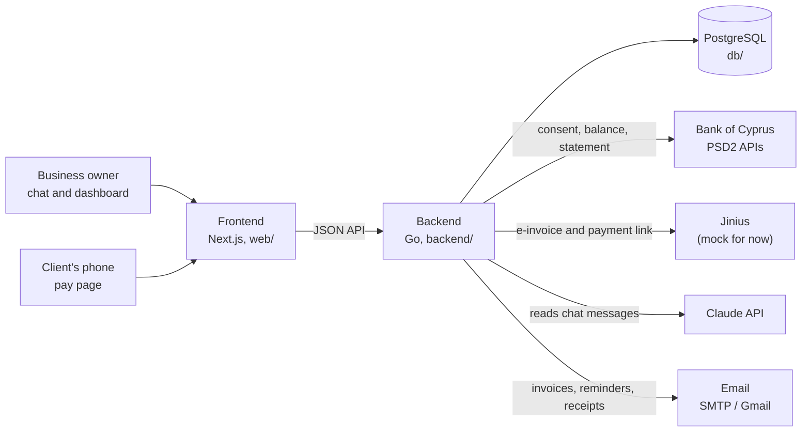

# Kerdos

**Kerdos** (κέρδος, Greek for "profit") is an AI assistant that helps small businesses in Cyprus get paid on time and see cash gaps before they happen. It is built on Claude and the Bank of Cyprus APIs, with Jinius for e-invoicing.

This document is the one place for the whole project: the idea, the demo, how to run it, the integrations and what is still open. The folders keep only short technical references (see [Where the rest lives](#where-the-rest-lives)).

## The hackathon

- **Event:** Bank of Cyprus Fintech Hackathon 7.0, 27–29 November 2026, IDEA Innovation Center, Nicosia. https://bochackathon.net/en/
- **Team:** Kerdos (same name as the product), 3 people.
- **Track:** #4 Fintech for SMEs & Entrepreneurship (also touches #3 Open Banking & Embedded Finance).
- **Prizes:** €7k / €4k / €2k, plus €2k for Best use of Jinius APIs, a key target for us.
- **Rules:** a working MVP, and the code in a public repo under CC BY-SA 4.0.
- **Judging:** innovation, technical soundness, automated data visualisation, use of open APIs, feasibility, and commercial or social impact.

## The problem

Cafés, tradespeople and freelancers rarely fail for lack of customers. They fail because money comes in later than it goes out:

- **Late payments.** Invoices go out over WhatsApp or on paper, clients pay 45–90 days late, and chasing them is awkward and slow.
- **Cash gaps.** Owners find out the account will go negative only when a payment already fails: rent, salaries, the 13th salary, insurance, the winter drop.

## What Kerdos does

1. **Invoice in one sentence.** "Invoice Kostas, 3 hours at €40" becomes an invoice. It goes out at once with a payment link, plus an email copy.
2. **Chases payments for you.** Reminders start after the due date and get firmer each time (polite → firm → final). The owner always sees who owes what.
3. **Warns you before you go negative.** The forecast combines the bank balance, upcoming bills, and each unpaid invoice on the day *that client* usually pays: "In 12 days you'll be €800 negative."
4. **Lets you act early.** When a gap is coming, the owner sees who owes what and can remind any client at once.

Planned after the first brief, not built yet: Google sign-in, Google Sheets sync and export (only the CSV export exists so far), Gmail reminders with editable templates and an optional Claude draft, and a spending forecast by category against a monthly budget (alert above 80%). The cash-gap forecast stays the headline.

**Out of scope:** physical cash in the till (the bank can't see it) and a WhatsApp channel (email only for the MVP).
**Nice to have, if time allows:** Greek / English / Russian translation for expats, a client reliability score, and a "what if" chat ("Can I afford to hire someone?").

## Value for the bank

- Invoices and payments flow through Jinius and BoC accounts.
- A small fee on each invoice paid through a Kerdos payment link, like card acquiring (a working assumption, see [docs/pitch.md](docs/pitch.md#business-model)).
- Business clients stay, because their invoicing lives in the bank's app.
- It brings new SME clients to BoC.

## The 2-minute demo

1. The owner types **"Invoice Kostas €120"**. The invoice arrives on a second phone in the room, and Kostas can pay it there.
2. **Skip time** by 3 days. A deposit lands, and Kerdos sends Andreas a firm reminder automatically.
3. Kostas opens the link on the second phone and pays. The invoice turns **Paid** and its reminders stop.

The commands for each step are under [Run the demo](#run-the-demo).

**Before going on stage:**

- Set `KERDOS_BANK=mock`, so the demo never waits on the bank sandbox.
- Email is real when the `SMTP_*` settings are filled in (Gmail). Check every sample client's address first, or leave `SMTP_*` empty so emails are only logged.
- Point Kostas at the second phone: `UPDATE counterparties SET email = '<demo phone email>' WHERE name LIKE 'Kostas%';`
- Reset the story before each rehearsal: `POST /api/demo/reset`.
- Rehearse twice and record a backup video of the demo.

## How it fits together



- **Database:** the business rules live in PostgreSQL views and functions: overdue status, reminders due, the forecast, financing. The API and the tests use the same rules. Details: [`db/README.md`](db/README.md); the data model and the team decisions: [`docs/data-model.md`](docs/data-model.md).
- **Backend:** a Go JSON API that owns all logic and every integration. Each outside service sits behind an interface with a mock, so **the demo never depends on a service being up**. Its endpoint table in [`backend/README.md`](backend/README.md) is the contract; `web/lib/api/types.ts` mirrors its JSON.
- **Frontend:** a Next.js app in `web/` that only shows what the backend returns ([`web/README.md`](web/README.md)).
- **Settings:** only through environment variables; every one is in [`.env.example`](.env.example). No secrets in the repo.

## Quick start

You need Docker and Node.js 20+. Go is optional: the `api` service below runs the backend in a Go container.

**0. Settings.** Create `db/.env` (never commit it):

```
KERDOS_DB_PASSWORD=<choose a password>
KERDOS_DB_PORT=5433
```

`KERDOS_DB_PORT` is the port on your computer (default 5432). Use **5433** whenever something else already holds 5432, such as another PostgreSQL installed on the laptop, and use the same port in `KERDOS_DATABASE_URL`. A `.env` in the repo root is read by the backend too (copy it from `.env.example`). Leave `SMTP_*` and `KERDOS_BANK` unset for the demo, or real emails go out to the sample clients' addresses.

```sh
# 1. Database: start, create the schema, load the demo data
docker compose -f db/compose.yaml --env-file db/.env up -d db
docker compose -f db/compose.yaml --env-file db/.env run --rm migrate up
docker compose -f db/compose.yaml --env-file db/.env exec -T db   psql -U kerdos -d kerdos -v ON_ERROR_STOP=1 --single-transaction < db/seed/sample.sql

# 2. Backend on http://localhost:8080 (first start downloads Go modules, about a minute)
docker compose -f db/compose.yaml --env-file db/.env --profile app up -d api
curl http://localhost:8080/healthz          # {"ok":true,"db":"ok",...}
#    or, with Go 1.22+ installed: cd backend && go run ./cmd/kerdos-api  (needs KERDOS_DATABASE_URL)

# 3. Frontend on http://localhost:3000
cd web
npm install
npm run dev
```

**Database created before 27 Nov?** The schema was rewritten in place (still migration 1), so an older local database must be emptied first: `docker compose -f db/compose.yaml --env-file db/.env down -v` deletes it; then run step 1 again.

No keys are needed: the bank, Jinius, email and chat parsing all have working mocks. Add `ANTHROPIC_API_KEY`, the `SMTP_*` settings or `KERDOS_BANK=boc` with the `BOC_*` settings to switch the real ones on.

On Windows PowerShell, several of these commands need small changes: see [Windows (PowerShell)](#windows-powershell) below.

### Run the demo

In the app's Chat, send "Invoice Kostas €120". Then skip 3 days with `curl -X POST localhost:8080/api/demo/skip -d '{"days":3}'` (Andreas gets a firm reminder), then pay Kostas's invoice from its link ("Pay now"). `curl -X POST localhost:8080/api/demo/reset` starts the story again. Every step as an API call: [`backend/README.md`](backend/README.md#the-demo-through-the-api).

## Windows (PowerShell)

The commands in these READMEs are written for bash (macOS, Linux, Git Bash, WSL). In Windows PowerShell, change them like this. Run everything from the repo root unless a step says `cd backend`, and make sure Docker Desktop is running first.

| In bash | In PowerShell | Why |
|---|---|---|
| A trailing `\` continues the line | Write it on one line, or end the line with a backtick `` ` `` | `\` is an ordinary character in PowerShell |
| `command < file.sql` | `cmd /c "command < path\file.sql"` | PowerShell has no `<`. `cmd` passes the file through byte for byte, so `€` and Greek letters survive |
| `curl -X POST … -d '…'` | `Invoke-RestMethod -Method Post …` (below), or `curl.exe` | `curl` is an alias for `Invoke-WebRequest`, which takes different options |
| `NAME=value command` | `$env:NAME = "value"; command` | There are no inline environment variables. The variable stays set until you close that window |
| `cp .env.example .env` | `Copy-Item .env.example .env` | |

### Database and backend

```powershell
docker compose -f db/compose.yaml --env-file db/.env up -d db
docker compose -f db/compose.yaml --env-file db/.env run --rm migrate up
cmd /c "docker compose -f db/compose.yaml --env-file db/.env exec -T db psql -U kerdos -d kerdos -v ON_ERROR_STOP=1 --single-transaction < db\seed\sample.sql"
cmd /c "docker compose -f db/compose.yaml --env-file db/.env exec -T db psql -U kerdos -d kerdos -v ON_ERROR_STOP=1 < db\tests\demo_story.sql"
docker compose -f db/compose.yaml --env-file db/.env --profile app up -d api
Invoke-RestMethod http://localhost:8080/healthz
```

The seed command prints a line per statement (`INSERT 0 1`, `DO` and so on). If you see `ERROR`, it stopped and changed nothing, because it runs as one transaction. The demo test should end with `ALL DEMO STORY CHECKS PASSED`.

### The demo through the API

```powershell
$api = 'http://localhost:8080'
$h = @{ Method = 'Post'; ContentType = 'application/json; charset=utf-8' }

Invoke-RestMethod @h -Uri "$api/api/demo/reset"
(Invoke-RestMethod "$api/api/forecast").headline                     # In 12 days you'll be €800 negative.
(Invoke-RestMethod @h -Uri "$api/api/chat" -Body '{"text":"Invoice Kostas €120"}').messages[-1].text
(Invoke-RestMethod @h -Uri "$api/api/demo/skip" -Body '{"days":3}').messages | Select-Object role, text
$kostas = (Invoke-RestMethod "$api/api/invoices").invoices | Where-Object source -eq 'chat' | Select-Object -First 1
Invoke-RestMethod "$api/api/pay/$($kostas.pay_token)"                 # the client's page
Invoke-RestMethod @h -Uri "$api/api/pay/$($kostas.pay_token)"         # "Pay now"
```

- Keep `charset=utf-8`: without it, Windows PowerShell sends `€` in the wrong encoding.
- Add `| ConvertTo-Json -Depth 6` to see a whole reply instead of `@{…}`.
- With real curl, call `curl.exe`, escape the inner quotes, and leave out `€`, which curl can garble in arguments: `curl.exe -X POST localhost:8080/api/chat -H "Content-Type: application/json" -d '{\"text\":\"Invoice Kostas 120\"}'`

### Tests

```powershell
cd backend
go test ./...
docker compose -f ../db/compose.yaml --env-file ../db/.env exec -T db createdb -U kerdos kerdos_test
cmd /c "docker compose -f ../db/compose.yaml --env-file ../db/.env exec -T db psql -U kerdos -d kerdos_test -v ON_ERROR_STOP=1 < ..\db\migrations\000001_init.up.sql"
$env:KERDOS_TEST_DATABASE_URL = "postgres://kerdos:<password from db/.env>@127.0.0.1:<KERDOS_DB_PORT>/kerdos_test?sslmode=disable"
go test ./internal/httpapi/
```

### Other things that trip people up on Windows

- **Writing `.env` files.** In Windows PowerShell 5.1, `echo … > file` and `Out-File` save UTF-16, which Docker Compose and the backend can't read. Edit `.env` and `db/.env` in GoLand or VS Code (UTF-8), or use `Set-Content -Encoding ascii`.
- **Port 5432 is already taken.** A locally installed PostgreSQL often holds it (check with `Get-NetTCPConnection -LocalPort 5432`). Leave that one alone: set `KERDOS_DB_PORT=5433` in `db/.env` and use `:5433` in `KERDOS_DATABASE_URL`.
- **"running scripts is disabled on this system" from `npm`.** PowerShell's execution policy blocks `npm.ps1`. Run `npm.cmd install` and `npm.cmd run dev`, or allow local scripts once with `Set-ExecutionPolicy -Scope CurrentUser RemoteSigned`.
- **A firewall prompt every time you `go run`.** `go run` builds to a new temporary path, and listening on all interfaces (`:8080`) makes Windows ask again. Use the `api` container, set `KERDOS_HTTP_ADDR=127.0.0.1:8080` in `.env`, or build once with `go build ./cmd/kerdos-api` and run `.\kerdos-api.exe`.
- **"error during connect … dockerDesktopLinuxEngine".** Docker Desktop isn't running: start it and wait for the engine to be ready.
- **The database rejects the password.** Make sure `db/.env` has no stray spaces. If it was saved with Windows line endings, switch it to LF (bottom-right corner of the editor) and restart the database container.

## Integrations

Every integration has a mock behind the same interface. If an API blocks progress for more than about an hour, we stay on the mock: the demo must never break.

| Service | What Kerdos uses it for | Status (28 Nov) | Settings |
|---|---|---|---|
| **Claude** | Reads chat messages ("Invoice Kostas €120") through tool use | Works with a key. Any failure falls back to the rule-based parser | `ANTHROPIC_API_KEY`, `ANTHROPIC_MODEL` |
| **Bank of Cyprus** PSD2 sandbox ([portal](https://developer.bankofcyprus.com)) | Consent, accounts, balance, statement; incoming payments matched to invoices by number | App "Kerdos" registered, app token works. The client is tested against the documentation's samples. The consent screen in the sandbox stops at the OTP step, so a live sync hasn't run yet (question for the BoC mentors). How to connect: [backend/README.md](backend/README.md#connecting-the-boc-sandbox). Use `KERDOS_BANK=mock` for the demo. The Payments API ("pay by bank") is planned for "Pay now" | `KERDOS_BANK=boc`, `BOC_*` |
| **Jinius** (BoC B2B: e-invoicing, payments) | Sending the e-invoice with a payment link | Mock: the payment link is Kerdos's own pay page. Registration at https://b2b.integration.platform.cy is submitted and waiting for approval; then the client id and secret come from Settings → Developer. The API has `/v3/invoices` and `/v3/remittances` | `JINIUS_API_KEY` (not used yet) |
| **Email** | Invoice copies, reminders, receipts, the owner's summary | Real over SMTP (tested with Gmail and an app password), or only logged when `SMTP_HOST` is empty. Chat reports what really happened to each email; a failed one says why, and stays failed until it is retried (`POST /api/messages/{id}/retry`). Nothing is emailed about a cancelled invoice, and paid invoices are never chased | `SMTP_*` |
| **"Pay now"** | The client pays the invoice from its link | Simulated: no signed BoC payment initiation yet | |

## Status

| Part | State |
|---|---|
| Database schema, demo data, rules | Done; checked by `db/tests/demo_story.sql` |
| Backend API (chat, invoices, reminders, forecast, financing, pay page, demo controls) | Prototype; checked by an end-to-end test through the API |
| Next.js frontend (`web/`): overview, chat, invoices in both directions with CSV export, debtors, forecast and financing, reminders | Built on the backend API |
| Google Sheets sync, XLSX export | Not built yet. The web app's Invoices page exports CSV |
| Accounts: email and password or Google sign-in, an owner and invited members, account and team pages | Built; on with `KERDOS_AUTH=accounts` (the default, `dev`, has no sign-in) |
| Budgets, editing reminder rules and templates, Claude-drafted reminders | Not built yet |
| The client's pay page, a bank connection page and a Retry button for failed emails in the web app | Not built yet; the backend endpoints are ready (see [`web/README.md`](web/README.md)) |

All names, amounts and dates in the demo are sample data.

Invoice financing ("Get €800 now") is still in the code and the API from the first plan, but it is no longer part of the product, the demo or the pitch (see [docs/pitch.md](docs/pitch.md#business-model)).

### Open before the demo

- **No pay page in the web app.** The client's page `/pay/{token}` doesn't exist in `web/` yet (the backend's `GET /api/pay/{token}` is ready). Pay links point to `KERDOS_PUBLIC_URL`, which is `localhost` by default, so a second phone can't open them until the app is reachable on the network.
- **Reminders don't stop.** The sample policy leaves `max_reminders` empty, so after the third reminder Kerdos keeps sending the "final" tone. The plan is a maximum of 3.
- **The whole demo hasn't been run end to end** on the laptop yet.
- **Real services:** BoC consent (OTP step) and Jinius access, see [Integrations](#integrations).
- **Google Sheets, not decided:** the proposal for the demo is a service account that writes to one shared spreadsheet. Giving each user their own sheet needs Google sign-in first.

### Sunday

The deck and the 4-minute script follow [docs/pitch.md](docs/pitch.md): rehearse twice, record a backup demo video, check that the public repo is up to date.

**Principles:** 3 working features beat 6 broken ones. Keep the stack simple and easy to deploy.

## Where the rest lives

```
backend/    Go API. backend/README.md: settings, the endpoint table (the API contract), emails, tests, code layout
web/        Next.js frontend. web/README.md: run, pages, what is not built yet
db/         PostgreSQL schema (migrations), sample data, demo test. db/README.md: setup, conventions, what the database computes, "Skip time"
docs/       data-model.md: the data model and the team decisions behind it
.env.example      every setting, with comments (copy to .env, never commit .env)
```

## Licence

Released under [CC BY-SA 4.0](https://creativecommons.org/licenses/by-sa/4.0/), as the hackathon rules require.
